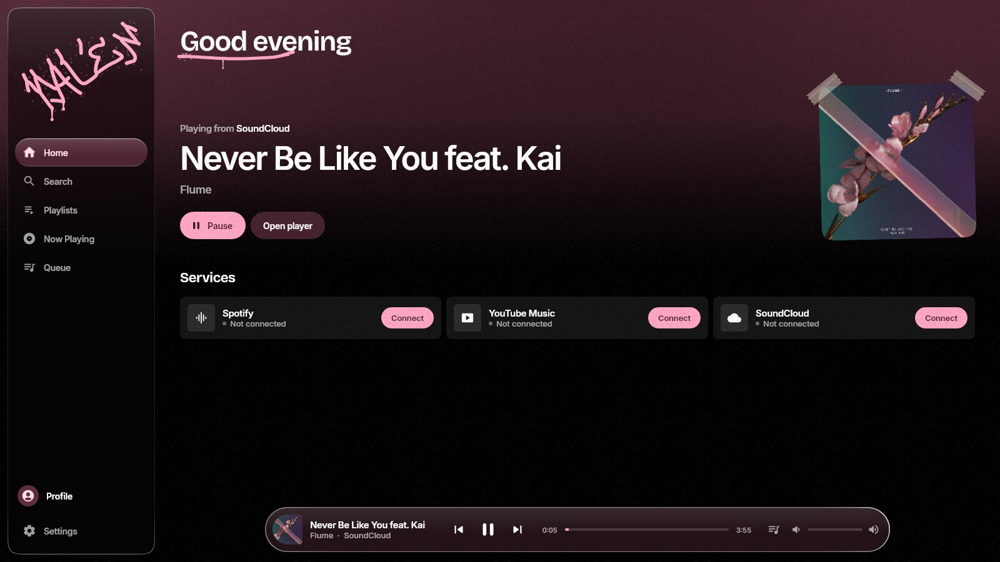
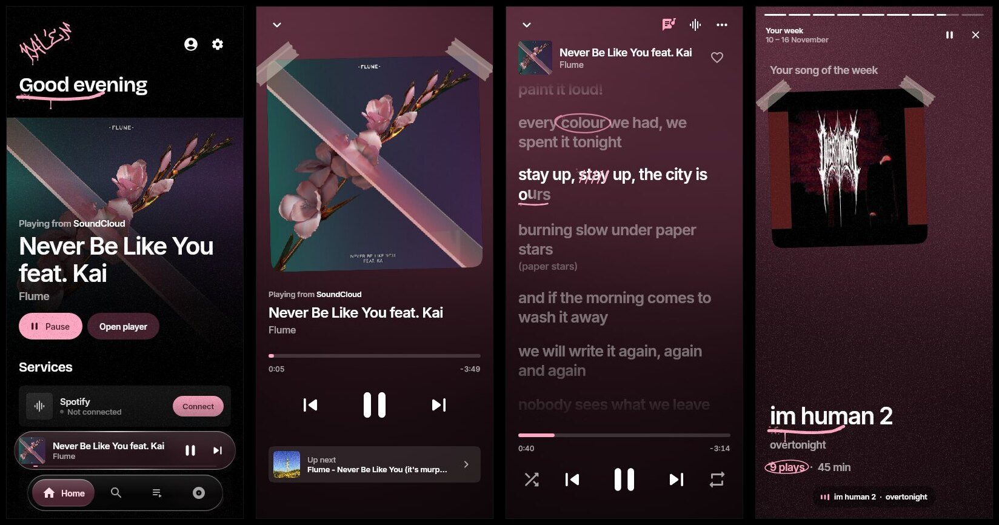

  <em>One player for Linux and Android — 3 Platforms; Spotify, YouTube Music and SoundCloud.</em>

Valen is a music player built once in Kotlin and shipped to Linux and Android: one queue, one now-playing stage, one library. A Spotify song can sit between a SoundCloud set and a YouTube Music album, and the app never asks you to remember which service it came from — only which one it is playing from, when you want to know.

## three services, one queue

The queue belongs to Valen. The three services are adapters behind one interface, so the UI never knows which service is playing and no service ever gets to invent a queue: Spotify, YouTube Music and SoundCloud each play exactly one track, in the order you put them.

Playback runs through each service's **own official player** — the Spotify Web Player in a private, hidden Chrome on the desktop, the YouTube Music web app, SoundCloud's own streams — so no DRM is circumvented, Valen never asks for a password, and it never keeps a token. Sign-in happens on the service's own page, inside Valen's own browser profile; disconnecting deletes that service's cookies. Playlists, likes and the queue are Valen's data: nothing is ever written back to an account.

<b>the plumbing, if you want it</b>

- **Spotify** plays through its official Web Player, driven over Chrome DevTools on the desktop and through a relayed WebView on Android. The page only fetches audio while it believes it has focus; on the desktop Valen emulates that focus, so the browser window may stay in the background.
- **YouTube Music and SoundCloud** are native on both platforms, with no browser at all: [NewPipeExtractor](https://github.com/TeamNewPipe/NewPipeExtractor) resolves a stream address and `ffplay` plays it on the desktop, while the same resolvers run through ExoPlayer on Android.
- **Spotify's streams are never downloaded.** Its audio is DRM-protected and its servers watch for bulk fetching, so a Spotify song you keep is kept as the same recording from YouTube Music (else SoundCloud), matched as strictly as a playlist import.
- **SoundCloud tracks that exist only as encrypted HLS are left out of search**, not decrypted. The same song on another service is the copy offered instead.

## the wall

One page, three widths. A wide window gets a 236dp side panel and a 72dp player dock around content that fills whatever is left — a wider window is room for more music, not for margin. Between 700dp and 1000dp the panel becomes an icon rail; below 700dp the dock becomes a floating tab bar, a mini-player capsule and full-screen sheets. Only screens you read rather than browse — Settings, Import — stop at a reading width.

Every page keeps its scroll and an open playlist stays open while the app runs; on the next start the last queue comes back, paused on the same song at the same place.

Home, with the cover's colour washing down the page.

## the small things

- **Downloads.** Any playlist, or any single song from its menu, can be kept.
- **Playlists.** Valen's playlists are the app's own, like the queue. Paste a Spotify, YouTube Music or SoundCloud link — or read a signed-in account's library — and Valen keeps the songs it can play exactly, matches the rest on the other services, and shows what matched nothing as unmatched rather than playing the wrong recording. Re-importing refreshes in place, a list keeps what you add or remove from it, and nothing is ever written back to an account.
- **Songs kept on disk.** YouTube Music and SoundCloud songs are kept as they play, and the next song is fetched ahead, so a song heard before starts at once with no lookup and no network. The desktop keeps up to 3 GB, Android up to 1.5 GB; the songs played longest ago go first.
- **Offline.** A list Valen keeps by itself: every song that plays with no network — downloaded, or kept whole after a listen. It appears with its first song, leaves with its last, and Settings → Downloads can hide it.
- **Local device.** You can listen to your local songs, playlists and mix them with cloud ones as one.
- **Artists.** Every artist has a page put together from Spotify and YouTube Music at once.
- **Taste and mixes.** Home's "For you", artist mixes and smart playlists score songs and artists from the welcome's favourites, listening time and early skips; Start radio plays the song you are on and then more, scored by your taste.

## credit

Valen is GPL-3.0. It stands on other people's work, and says so in [`NOTICE`](NOTICE):

- **[Orpheon](https://github.com/kota-zo/Orpheon)** — the Spotify Web Player playback and hidden-page plumbing, the YouTube Music page script, and the Immersive look that Valen's interface follows (GPL-3.0).
- **[Mochy Music](https://github.com/realidkroo/Mochy-Music)** — the design ideas: the tight semi-bold type, the full-bleed cover that fades into a black page, the ambient backdrop, liquid glass, the floating capsule player, the queue, and the matching approach in the playlist importer (GPL-3.0; files are Valen's own).
- **[Metrolist](https://github.com/mostafaalagamy/Metrolist)** — the approach to lyrics and the Lyprio lyrics provider, ported (GPL-3.0).
- **[Astra](https://github.com/Boof2015/astra)** — the parametric EQ filter model, presets and AutoEQ parsing (GPL-3.0).

Valen is not affiliated with Spotify AB, Google/YouTube or SoundCloud.

