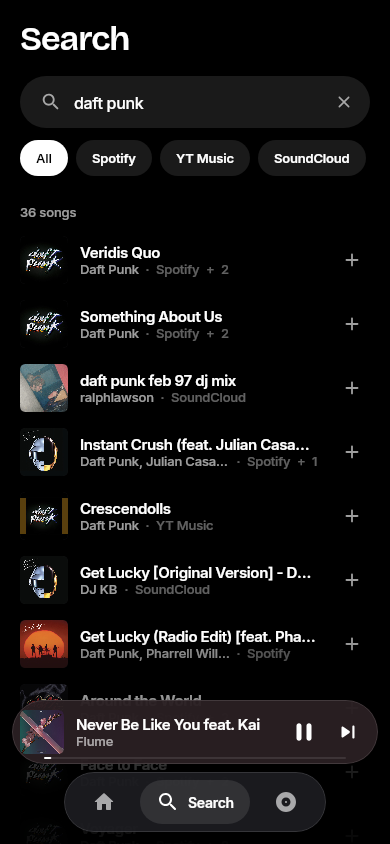
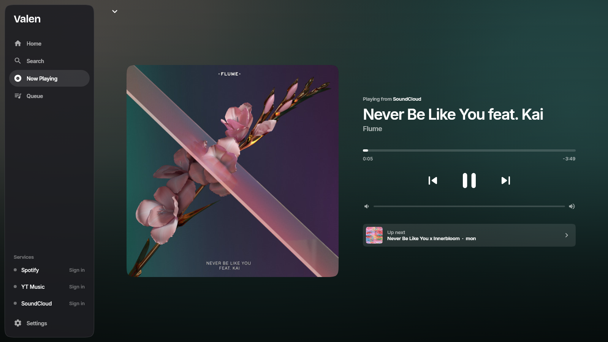
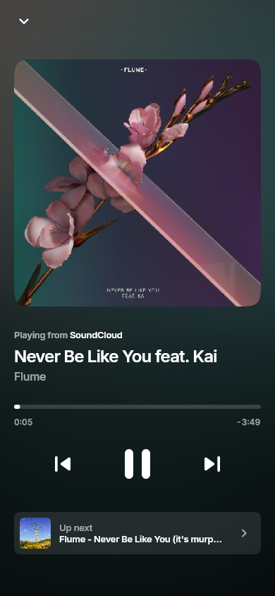

# Valen

A music player for **Spotify**, **YouTube Music** and **SoundCloud** with one library, one queue and
one now-playing screen. Linux desktop and Android share the same Kotlin source; the three services
are adapters behind one interface, so the UI never knows which service is playing.

Playback uses each service's **official web player** — the Spotify Web Player in a hidden page, the
YouTube Music web app, and SoundCloud's own progressive streams. Sign-in happens on the service's
own page, in Valen's private browser profile; Valen never asks for a password and never handles a
token itself. No DRM is circumvented.

## Screens

| Desktop (1600×900) | Phone (390×844) |
| --- | --- |
|  |  |
|  |  |
|  |  |
|  |  |
|  | |

The page is black and the only colour is the artwork that is playing: it washes the top of Home,
fills the Now Playing stage and tints the player. The chrome floats over the page: on a wide window
a 236dp side panel and a 72dp player dock, with the content filling whatever width is left — a
wider window is room for more music, not for margin. From 700dp to 1000dp the panel becomes an icon
rail. Below 700dp there is a floating tab bar with Home, Search and Now Playing, a mini player
capsule above it, and full-screen Now Playing and Queue sheets. Only screens that are read rather
than browsed (Settings) stop at a reading width. The visual rules live in
[`docs/design-spec.md`](docs/design-spec.md).

## Build and run (Linux)

Everything the build needs is project-local and git-ignored: JDK 21, Android SDK, Chrome and the
Gradle home live under `.tools/`. `scripts/env.sh` points the build at them.

Playing YouTube Music and SoundCloud natively needs `ffplay` from **FFmpeg** on `PATH`
(`ffmpeg` in the distribution's repositories; `$VALEN_FFPLAY_BIN` overrides the binary). Spotify
additionally needs a Chrome/Chromium, which Valen finds itself.

```bash
cd valen
source scripts/env.sh
./gradlew :app-desktop:run
```

A start opens no browser. YouTube Music and SoundCloud search through their APIs and play through
FFmpeg; Spotify starts Valen's private Chrome (its own profile, DevTools on `127.0.0.1:9333`) the
first time Spotify is used — searching with Spotify enabled or opening its settings tile. A normal
start takes no arguments.

Packaging: `./gradlew :app-desktop:packageDeb` writes
`app-desktop/build/compose/binaries/main/deb/valen_1.0.0_amd64.deb`; see [Packages](#packages) for
the AppImage step. A desktop entry and icon for a hand-rolled install live in `packaging/`.

### Development flags

The desktop binary takes a few flags for the screenshot pass; they are not needed to use Valen.

```
valen [--width N] [--height N] [--route home|search|now-playing|queue|settings]
      [--query TEXT] [--play PROVIDER:ID] [--screenshot PATH]
```

`--play ytmusic:"daft punk"` searches that service and starts the first result. `--screenshot`
draws the window offscreen, lets it settle for five seconds (artwork included) and writes a PNG,
then exits.

### Packages

Both installers were run from their unpacked output on this machine (no system install, no sudo):
a song played, MPRIS showed it, `position <s>` seeked and `next` advanced the queue. The AppImage
was rebuilt after the window-scaling fix and both its packaged UI and a real tiled window were
checked from the package (see below); the `.deb` dates from before the design rework and will be
rebuilt with the next packaging pass.
The packages do not carry FFmpeg; a machine without it plays Spotify only.

| Output | Built with | Size |
| --- | --- | --- |
| `app-desktop/build/compose/binaries/main/deb/valen_1.0.0_amd64.deb` | `./gradlew :app-desktop:packageDeb` | 95 MB |
| `app-desktop/build/compose/binaries/main/app/Valen-1.0.0-x86_64.AppImage` | `./gradlew :app-desktop:packageAppImage && ./scripts/appimage.sh` | 107 MB |

The current AppImage's sha256 is
`c3e2a23c55dbe8c133125f14f81bd3e4783cb7bfcaeeb88a4d6c0cb058d29f83` (111,962,616 bytes).

`packageDeb` needs `dpkg-deb` and `fakeroot`; the AppImage step needs `appimagetool`. Compose's
`packageAppImage` produces a jpackage app-image *directory* (`app/Valen/`), not a single file —
`scripts/appimage.sh` wraps that directory with a desktop entry, icon and `AppRun`, then calls
`appimagetool --no-appstream`. Run it with `--appimage-extract-and-run` where FUSE is unavailable.

The bundled runtime adds two JDK modules the trimmed runtime would otherwise leave out:
`jdk.security.auth` (dbus-java reads the uid through `UnixSystem`; MPRIS fails without it) and
`java.net.http` (the Chrome launcher probes DevTools with `HttpClient`). A packaged install still
needs a system Chrome/Chromium or `VALEN_CHROME_BIN`; the `.tools` Chrome is not shipped.

## Build and install (Android)

```bash
source scripts/env.sh
./gradlew :app-android:assembleDebug
adb install app-android/build/outputs/apk/debug/app-android-debug.apk
```

The debug package id is `app.valen.debug`; the release id is `app.valen`. Playback happens in
WebViews held by a foreground service, so audio continues with the screen off and the media
notification (play/pause/next/previous, lock screen, headset buttons) is the system control.
Google may refuse its account page inside an Android WebView; YouTube Music still plays signed out.

## Sign-in

- **Spotify** — Settings → Spotify → Connect opens the Web Player in the private Chrome page (desktop)
  or a full-screen WebView (Android). Free accounts play with Spotify's own ads.
- **YouTube Music** — Connect opens Google's sign-in page. Signed out, search and playback work; the
  account only adds the library and history.
- **SoundCloud** — Connect opens SoundCloud's own sign-in. Signed out, label tracks are 30-second
  previews, as SoundCloud serves them.

Sessions persist in the private browser profile per service. Disconnect deletes that service's
cookies. Nothing is written to the settings file except volume, quality and the last service.

## Configuration

| Variable | Meaning | Default |
| --- | --- | --- |
| `VALEN_FFPLAY_BIN` | `ffplay` used for native YouTube Music and SoundCloud playback | `ffplay` on `PATH` |
| `VALEN_CHROME_BIN` | Chrome/Chromium binary Spotify's page runs in | `.tools/chrome/opt/google/chrome/chrome`, then the usual system paths |
| `VALEN_CHROME_PROFILE` | Directory of the private Chrome profile | `$XDG_DATA_HOME/valen/chrome` |
| `XDG_DATA_HOME` | Parent of the Chrome profile | `~/.local/share` |
| `XDG_CONFIG_HOME` | Parent of `valen/settings.json` | `~/.config` |
| `VALEN_SPOTIFY_LOG` | `1` prints the Spotify Web Player bridge's own lines (refusals, device join, timeouts) to stderr | off |
| `VALEN_MPRIS_LOG` | `1` prints when the MPRIS service closes and from where | off |

No key, token, cookie or credential is stored in the repository. There are no build-time secrets:
`local.properties` and `.tools/` are git-ignored.

## Modules

| Module | Role |
| --- | --- |
| `core` | `Track`, `MusicProvider`, `ProviderSignIn`, `PlaybackCoordinator` (the one queue), settings |
| `ui` | Compose Multiplatform design system and the five screens, shared by both platforms |
| `libs/api`, `libs/web`, `libs/engine`, `libs/spotify`, `libs/ytmusic` | Orpheon's provider-neutral API, page bridge, Spotify Web Player and YouTube Music implementations (GPL-3.0, vendored with headers) |
| `libs/audio` | Native playback: `FfplayPlayer` (one FFmpeg process per stream), `NativePlayback` (snapshot/events), `YoutubeAudio` (NewPipeExtractor), `SoundcloudAudio` (API + runtime client id) |
| `providers/spotify` | Spotify adapter on the vendored Web Player |
| `providers/native` | Desktop YouTube Music and SoundCloud adapters: no page, no browser |
| `providers/ytmusic`, `providers/soundcloud` | The page-based adapters Android still uses (hidden WebView); desktop no longer builds them |
| `host/desktop` | Chrome launcher, CDP page hosts, desktop sign-ins, MPRIS |
| `host/android` | WebView page hosts, Widevine, Android sign-ins, foreground playback service |
| `app-desktop`, `app-android` | Entry points and platform wiring |

The contract every adapter implements is in [`docs/provider-contract.md`](docs/provider-contract.md).
`PlaybackCoordinator` owns the queue and calls exactly one adapter at a time; adapters never invent a
queue of their own.

## What is verified

- Desktop app builds and runs; YTM and SoundCloud play **signed out** with position advancing and the
  queue auto-advancing, with **no browser process started**: verified on a machine with no Chrome
  open (YouTube Music: 264 s track, pause froze the clock, resume continued, `seek 120` restarted
  FFmpeg at 120 s, and a seek to 261 s advanced to the next queue song).
- Spotify plays a signed-in account on the desktop: a song starts, its position advances, `next`
  and `previous` move through Valen's queue, `seek` jumps, pause/resume work, and the queue
  auto-advances at the end of a song — all with the Chrome window in the background and the app
  driven over MPRIS (`playerctl -p valen ...`).
- MPRIS: `playerctl -p valen status|metadata|position|pause|play|next|previous` drives the app;
  `position <seconds>` seeks. (A seek used to take the whole MPRIS name off the bus: the `Seeked`
  signal was assembled by hand and reached the daemon malformed; it is now declared as part of the
  MPRIS player interface, as dbus-java requires.)
- The `.deb` and the `.AppImage` were unpacked and run end to end: each starts its private Chrome
  cold, draws the UI, plays Spotify, registers MPRIS, seeks and advances the queue.
- **Tiled windows fill correctly**: on niri, a window resized by the compositor (including
  `expand-column-to-available-width`) now takes Compose's content window with it — frame, content
  window and Skia canvas all measured 1874×998 where they used to be a 1440×900 drawing stuck in
  the corner. Verified with the distributable and again from the rebuilt AppImage. The fix is
  AWT's own non-reparenting switch, set from `Main.kt` for tiling compositors only, with the
  package opening `java.desktop/sun.awt.X11` for it.
- Mouse interaction on a real window (hover, rail dragging, queue drag, page cross-fade) is still
  unverified; only geometry and rendered frames were checked.
- Android debug APK builds (`app-android/build/outputs/apk/debug/`), foreground service and
  notification included; no device was available, so runtime behaviour there is unverified.
- Core queue/settings tests (`./gradlew :core:jvmTest`), SoundCloud parser tests, and the vendored
  Orpheon test suites pass.
- The interface is walked by `./gradlew :ui:jvmTest` against services that answer instantly: every
  screen at four window sizes, then search → play → queue → stage → settings on a wide window and
  the two sheets on a phone.

Known limits: native playback needs `ffplay` (a machine without FFmpeg plays Spotify only, and the
first play says so); the streaming (HLS) SoundCloud tracks the old page adapter refused now play,
but SoundCloud keeps some tracks preview-only when signed out; Spotify signed-out search waits for
the Web Player to start and refuses after 8 s; the Android build still plays YTM/SoundCloud through
a hidden WebView (no visible browser), so ExoPlayer on Android is the next step;
YouTube Music reports its own ads and they play through. Spotify playback with a real account needs
one manual sign-in in the private Chrome page — the free-account path is Orpheon's, including its
documented refusals. **The Spotify Web Player only fetches a song's audio while its page has focus**
(an unfocused page accepts the play command, its media element stays at `readyState 0` and no audio
is requested). On the desktop, Valen emulates that focus over CDP
(`Emulation.setFocusEmulationEnabled`), so the Chrome window may stay in the background; the
Android WebView has no equivalent switch, and a backgrounded WebView is unverified.

## Licence and credit

GPL-3.0. Valen reuses Orpheon's Spotify/YouTube Music playback code and page plumbing, resolves
YouTube streams with NewPipeExtractor, plays them through FFmpeg (`ffplay`), and borrows design ideas
from Mochy
Music's design ideas; see [`NOTICE`](NOTICE) for the file-level credits, fonts (Bricolage Grotesque,
Inter) and the icon set (Material Symbols Rounded).
