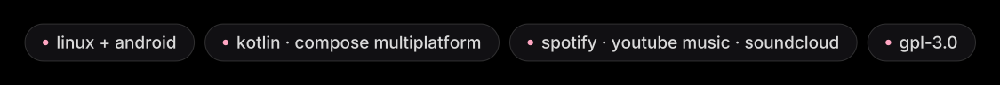
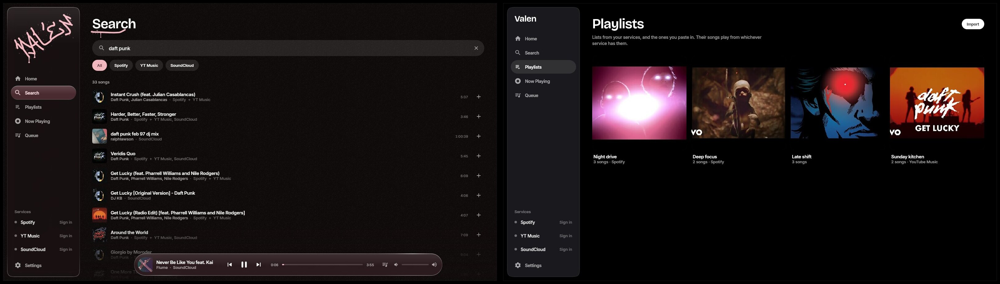
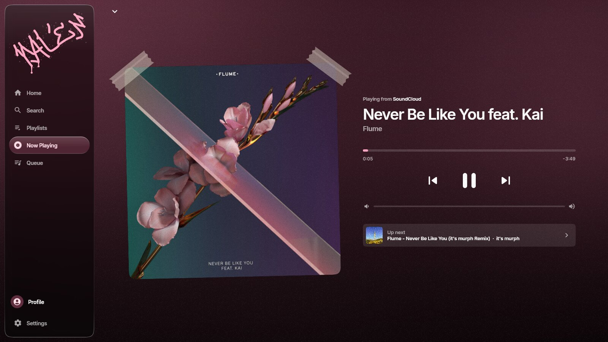
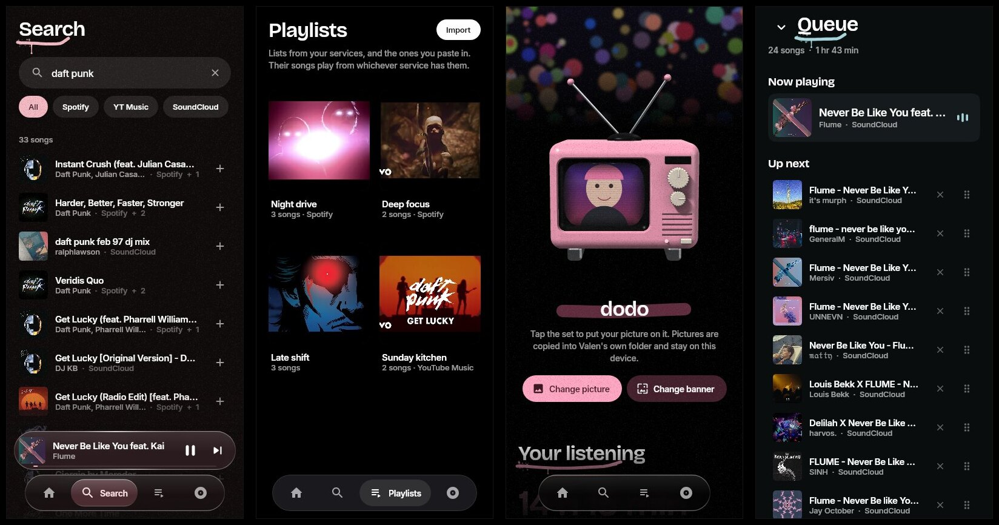
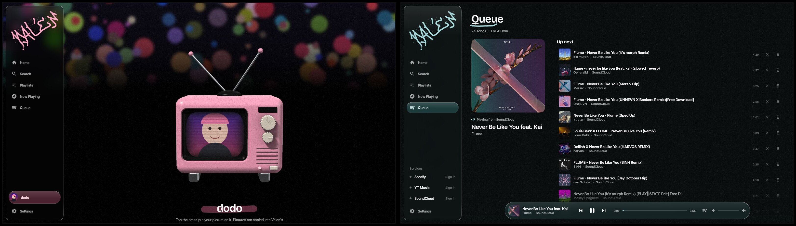
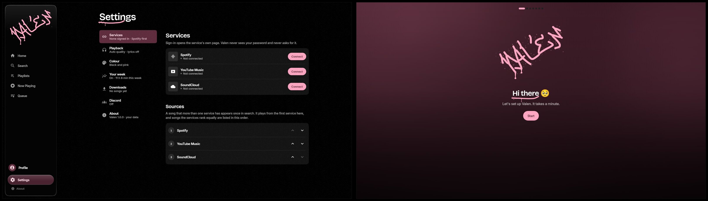

<p align="center">
  
</p>

<h1 align="center">music isn't supposed to feel static.</h1>

<p align="center">
  <strong>One beautifully restless place for everything you listen to.</strong>
  <br>
  Spotify, YouTube Music, SoundCloud, and your own files.
  <br>
  Made for Linux and Android. Made to feel alive.
</p>

<p align="center">
  <a href="#the-experience">the experience</a> &nbsp;·&nbsp;
  <a href="#all-your-music-one-place">the music</a> &nbsp;·&nbsp;
  <a href="#the-details">the details</a> &nbsp;·&nbsp;
  <a href="#build-valen">build it</a>
</p>

<p align="center">
  
</p>

<p align="center"><sub>In active development. Valen is not ready for everyday use just yet.</sub></p>

## the experience

Valen is a music player with a personality. Not another catalogue wrapped in a sidebar, but a whole little world built around the thing you're playing.

The screen takes its colour from the cover. Light drifts across the background. The player floats in glass. Album sleeves look pasted to the wall, titles write themselves into place, and moving between pages feels like changing scenes instead of opening tabs.

**Every animation has a reason to exist. Even the quiet moments have something to say.**


<p align="center"><sub>A desktop that belongs to the music, not a streaming service.</sub></p>


<p align="center"><sub>The same visual language, from a big desktop window to a phone in your hand.</sub></p>

## all your music. one place.

**Your taste doesn't stop at the edge of a streaming service. Why should your queue?**

Search across Spotify, YouTube Music and SoundCloud, arrange tracks from different sources together, and listen in the order you chose. Add local files alongside them. The queue is Valen's, not any one provider's.



A track that exists in several places appears once in search, with its available sources. Playlists can be imported from service links or connected accounts, with careful matching across providers when the original source can't play a track.

No need to rebuild your listening habits around whichever app happened to have the song.



## nothing sits still.

Valen's look isn't a coat of paint. Movement is part of how the interface speaks.

- **Colour that follows the record.** Keep the black-and-pink signature or let the artwork set the palette. Changes ease into one another as songs change.
- **Glass with a pulse.** Floating playback controls, a translucent dock and navigation that moves rather than simply snapping between selections.
- **Motion with character.** Pages pour, spray, roll and settle into place. Cover art arrives like a freshly pasted poster. Titles, ink and controls have their own entrances.
- **One design, two screens.** The same visual identity runs through the Linux desktop and Android interfaces, without forcing a desktop layout onto a phone.



<p align="center"><sub>Not a static player screen. A little stage for whatever is on.</sub></p>

## get closer to the music.

Lyrics aren't an afterthought tucked under a cover. Valen gives them room to breathe, with time-synced lines and word-level timing where the source provides it.



And when the sound itself matters, there's a place to shape it. Valen's sound controls include equalizer presets and a parametric EQ, with AutoEQ support.



## the songs stay with you.

A music player should remember more than the last thing you pressed play on.

Valen keeps a local listening history, builds personal recommendations from what you actually finish or skip, and offers mixes and radio for when you want to discover something without starting over.

Then there's **Your week**, a visual little recap of the songs and artists that followed you around.



## the details

| | |
| :--- | :--- |
| **One library, your rules** | Build local playlists, import from music services, and mix cloud and local tracks without writing changes back to your streaming accounts. |
| **Take it offline** | Download songs and playlists, cache native streams as you listen, and find saved music in an automatic Offline playlist. |
| **A proper queue** | Reorder what's next, combine sources, and let the next native stream prefetch while the current track plays. |
| **Artist pages** | Explore artist information and music brought together from Spotify and YouTube Music. |
| **Discord presence** | Show what you're listening to, with editable text, art, buttons and a live preview of your activity card. |
| **Desktop integration** | MPRIS support for Linux media keys, player controls and desktop widgets. |
| **Updates** | A built-in update flow for packaged Linux and Android builds, with download verification before installation. |
| **Made in Kotlin** | A shared Compose Multiplatform interface, with desktop and Android hosts and a provider-based playback engine. |

<details>
<summary><strong>more of the interface</strong> · search, playlists, profile, queue, settings and onboarding</summary>

<br>







</details>

## build valen

Valen is **still in alpha development**. This is a look at where it's heading, not a promise of a polished release today.

The project is built with **Kotlin and Compose Multiplatform**. For local development you'll need **JDK 21**. The Android build also requires an Android SDK.

```bash
git clone https://github.com/aethctl/valen.git
cd valen

# Linux desktop
./gradlew :app-desktop:run

# Android debug APK
./gradlew :app-android:assembleDebug
```

On Linux, native YouTube Music and SoundCloud playback needs **FFmpeg's `ffplay`**. Spotify desktop playback needs **Chrome or Chromium** for its Web Player. See [packaging](packaging/README.md) for the exact runtime requirements and [releasing](RELEASING.md) for how distributable builds are made.

**One important limitation:** Spotify playback is currently disabled on Android. Valen can try to resolve matching Spotify tracks through YouTube Music or SoundCloud instead. Service availability and sign-in requirements still apply.

Follow the [roadmap](TODO.md) for what's being built next, or browse the [source](https://github.com/aethctl/valen).

## built with love, and good open-source work.

Valen is licensed under **[GPL-3.0](LICENSE)**. Its foundations and influences deserve their flowers:

- **[Orpheon](https://github.com/kota-zo/Orpheon)** for Spotify Web Player integration, page scripts, YouTube Music work and the base immersive UI direction.
- **[Mochy Music](https://github.com/realidkroo/Mochy-Music)** for visual inspiration and playlist-matching ideas. Valen's code was written from scratch.
- **[Metrolist](https://github.com/mostafaalagamy/Metrolist)** for lyrics handling and the Lyprio lyrics provider.
- **[Astra](https://github.com/Boof2015/astra)** for the parametric equalizer model, presets and AutoEQ parsing.

Full third-party attribution lives in [NOTICE](NOTICE). Valen is not affiliated with Spotify, Google, YouTube or SoundCloud.

<details>
<summary>a note about development</summary>

LLMs have assisted with development. The direction, architecture and much of the implementation are human-led. The project and its dependencies remain available to inspect in the open.

</details>

<p align="center">
  
</p>

<p align="center">
  <sub>made for the songs you keep coming back to.</sub>
</p>
