# Valen

A music player for **Spotify**, **YouTube Music** and **SoundCloud** with one queue and one
now-playing screen. Playlists live in Valen's own library — pasted in from any of the three
services or added from a signed-in account — and are never written back to an account. Linux
desktop and Android share the same Kotlin source; the three services are adapters behind one
interface, so the UI never knows which service is playing.

Playback uses each service's **official web player** — the Spotify Web Player in a hidden page, the
YouTube Music web app, and SoundCloud's own progressive streams. Sign-in happens on the service's
own page, in Valen's private browser profile; Valen never asks for a password and never handles a
token itself. No DRM is circumvented.

## Screens

| Desktop (1600×900) | Phone (390×844) |
| --- | --- |
| 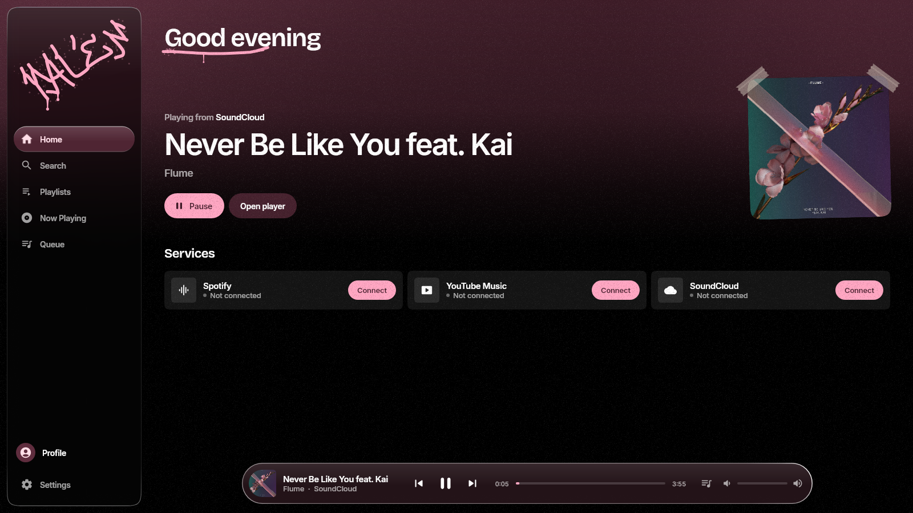 | 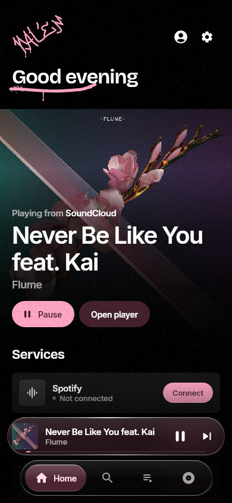 |
| 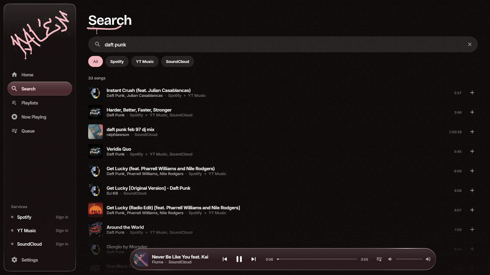 | 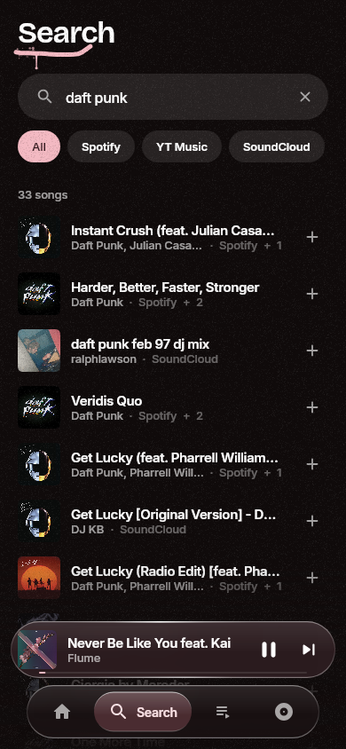 |
| 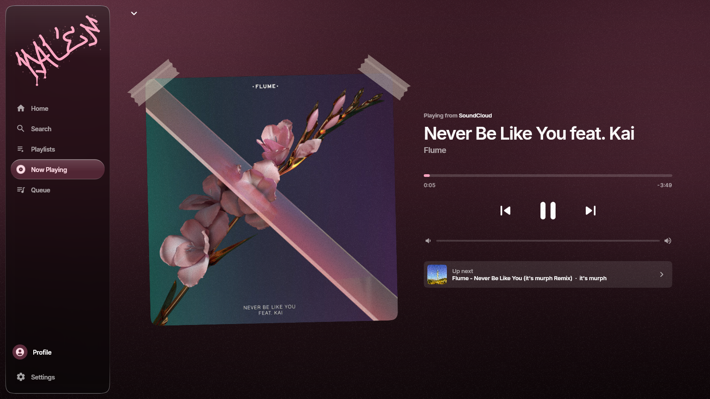 | 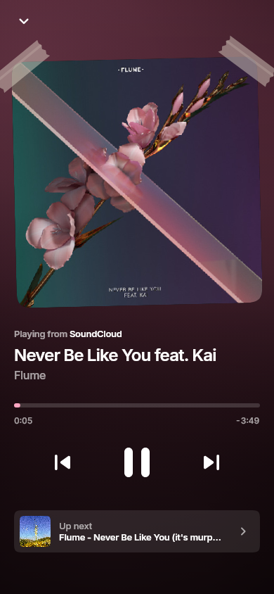 |
| 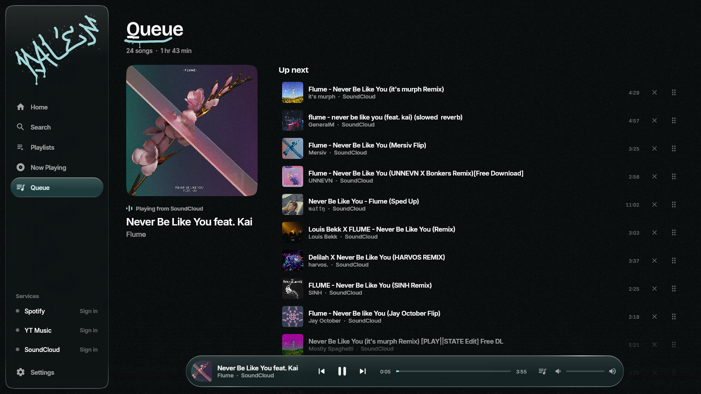 | 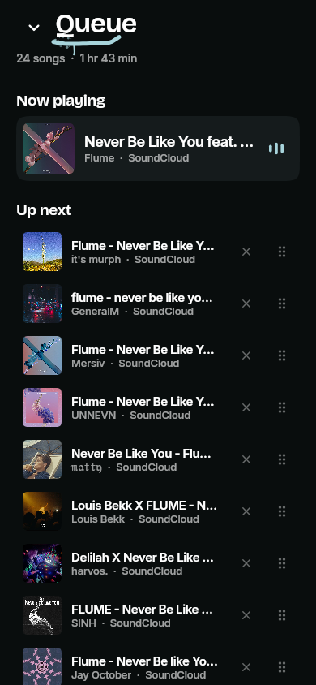 |
| 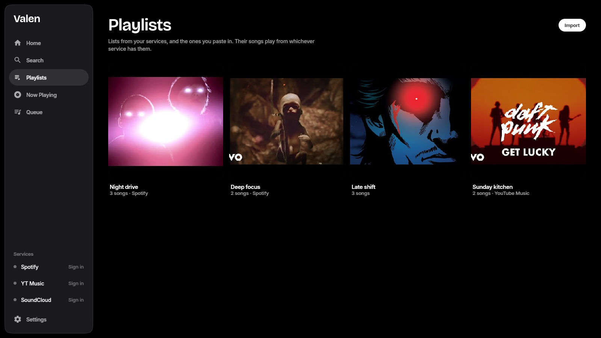 | 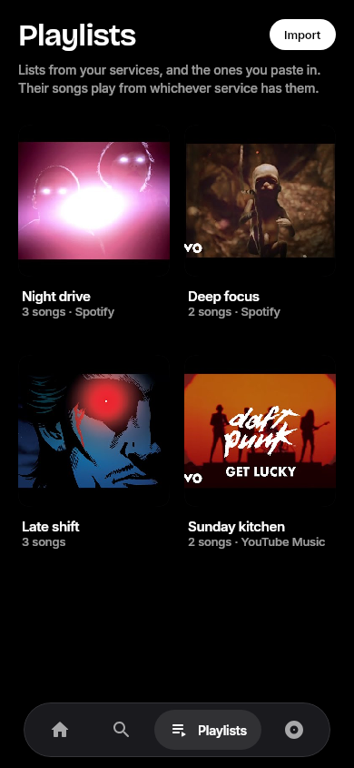 |
| 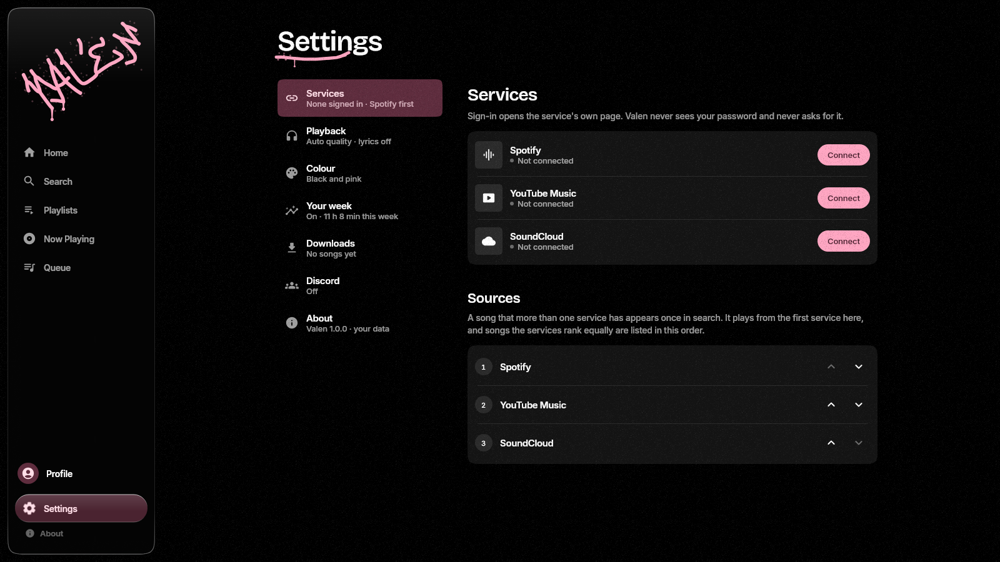 | |

The page is black and the only colour is the artwork that is playing: it washes the top of Home,
fills the Now Playing stage and tints the player. The chrome floats over the page: on a wide window
a 236dp side panel and a 72dp player dock, with the content filling whatever width is left — a
wider window is room for more music, not for margin. From 700dp to 1000dp the panel becomes an icon
rail. Below 700dp there is a floating tab bar with Home, Search, Playlists and Now Playing, a mini
player capsule above it, and full-screen Now Playing, Queue and Import sheets. Only screens that are
read rather than browsed (Settings, Import) stop at a reading width.

Shuffle and repeat (off → all → one) sit either side of the transport on the stage and the dock.
Every page keeps its scroll, and an open playlist stays open, for as long as the app runs; on the
desktop a scrollbar on the right edge can be dragged. On the next start the last queue comes
back, paused on the same song at the same place (`settings.json` → `session`).

Every song has one menu: ⋯ on the stage, the dock and each row; a right click on the desktop; a
long press on a phone (the mini player too). On a wide window it is a glass panel that grows out of
what opened it; on a phone it is a sheet from the bottom. It holds the heart (Liked songs), Play
next, Add to queue, Start radio (the song, then more by its artist scored by your taste), Add to
playlist (with New playlist right there), Share (the phone's share sheet, or the link copied on a
desktop), Open on the song's service, and from the player the sleep timer (15/30/45/60 min or the end
of the song; the stage shows the time left), volume on a phone, and Keep screen on (Android). The
visual rules live in [`docs/design-spec.md`](docs/design-spec.md).

## Sound

Effects for every song a player can take them for, set in a notebook (the stage's equalizer
button, or Sound in the player's menu). The left page has the song pasted in with a few facts about
it, and under it the notebook takes notes of what is done to the sound — written in as each setting
settles, struck out and rewritten as it changes. The right page holds the settings behind tabs:

- **Presets** — Flat, Bass boost, Vocal, Bright, Warm, Acoustic, Rock, Hip-hop, Electronic,
  Slowed + reverb, Nightcore, Concert hall, 8D, Lo-fi, Underwater, Late night.
- **EQ** — ten bands (31 Hz–16 kHz, ±12 dB), drawn as the curve really applied (bands, shelves,
  cuts and preamp together); drag or tap a band's column, double tap to flatten it.
- **Time** — speed 0.5×–2× and pitch ±12 semitones on two rulers, apart (pitch kept) or tied like a
  turntable ("Pitch follows speed").
- **Space** — reverb (amount, room from small room to cave, dark to bright: a convolution with a
  room Valen writes itself), echo (amount, time, repeats), stereo width (mono to twice as wide), 8D.
- **Tone** — bass and treble shelves, low cut, muffle (a high cut), even out (a compressor), preamp.

Everything ends in a limiter, so no setting clips. On Linux FFmpeg applies it (`ffplay -af`;
rubberband for speed and pitch where FFmpeg has it, a resample and atempo where not); a change
restarts the stream where it is once the control settles. Volume drags are also coalesced into one
restart, but either change can still cause an audible gap. On Android the same settings run inside
ExoPlayer's audio chain (Valen's own filters, compressor, echo, a Freeverb-style reverb, width, 8D
and the limiter, then ExoPlayer's speed and pitch); a change takes effect on the next buffer, with
no restart and no gap. Spotify keeps its sound locked (its audio is DRM-protected), and the notebook
says so while a Spotify song plays. The settings are kept in `settings.json` (`sound`).

The shared backend also supports an independent Astra-compatible parametric EQ: up to 20 peaking,
shelf or pass filters, adjustable frequency, gain and Q, its own preamp, Astra preset JSON and AutoEQ
text parsing. It runs alongside the notebook's fixed EQ and effects; its built-in presets, saved
presets and per-output profile storage are available through core APIs, but are not yet exposed in
the notebook or automatically selected when an output changes.

## Lyrics

The stage shows the song's words (the lyrics button beside Sound; Valen remembers the choice). On a
wide window the cover sits back and the words take the column beside it; on a phone they stand
where the cover was, under the song's line. The line being sung stands forward, its words filling in
as they are sung; a tap on a line plays from it; a scroll looks around and the words find the song
again after a moment. Pauses in the singing show as three dabs of paint that fill across the gap.

When the lyrics are timed word by word, the marker pen goes over the words once they are sung —
struck through, struck twice, crossed out with an X, scratched out, hatched, zigzagged under,
boxed, circled, underlined with paint running from a held note, swiped over, or given a burst when
shouted — about one word in six, the same way every time for the same song. Lyrics timed by line
light up line by line; untimed ones read as a page. Settings → Lyrics turns the stage's words on,
and the pen marks or the moving words (rise, ripple, pour) off.

Words come from **Lyprio** when it is set up, then from **Spotify's own lyrics** for a signed-in
account (only while its Web Player is already up: a lyrics lookup never starts the browser), then
from **LRCLIB** (lrclib.net, open, no key, timed by line). Lyprio searches many sources at once and
is the one that brings word timing. It is a signed service whose address and key are not part of
Valen's source; give them to Valen as `VALEN_LYPRIO_URL` and `VALEN_LYPRIO_KEY` (or Metrolist's
names, `LYPRIO_BASE_URL` and `LYPRIO_HMAC_KEY`) in the environment, or in
`~/.config/valen/lyprio.json`:

```json
{"url": "https://…", "key": "<base64 of a 32-byte key>"}
```

A build reads the same two names from a Gradle property, the environment or `local.properties`
(git-ignored) and carries them into both the desktop app and the APK; this machine's builds use the
endpoint Metrolist itself ships. Found lyrics are kept in `~/.cache/valen/lyrics` (Android: the
app's cache); a song no source has is not asked about again for three days.

## Artists

Every artist has a page, put together from Spotify and YouTube Music at once: their picture and
story, monthly listeners and followers, their most played songs (each once, played from the service
that can play it here), their albums, singles and compilations (an album on both services shows
once), what they appear on, the playlists that feature them and the artists their fans also like.
Albums and those playlists open in place, with Play, Shuffle and, for a playlist, Save. A page is
reached by searching their name (the Artists row above the songs), from Home's "Your artists", by
the artist's name on the stage while their song plays, or "Go to artist" in any song's menu.
Spotify's part needs a signed-in Spotify; without one the page is YouTube Music's.

## Songs kept on disk

YouTube Music and SoundCloud songs are kept on disk as they play, and the song up next is fetched
ahead, so a song heard before (or the next one) starts at once with no lookup and no network. The
desktop keeps up to 3 GB in `~/.cache/valen/audio` (whole files; never more than a quarter of the
free space), Android up to 1.5 GB in the app's cache (ExoPlayer's own cache, which the system may
clear when storage runs low). The songs played longest ago go first. Long mixes (over an hour),
copy-protected streams and, on Android, SoundCloud's segmented (HLS) streams are not kept.

## Offline, and songs that start at once

**Offline** is a list Valen keeps in your library by itself: every song that plays with no
network — downloaded, or kept whole by the song cache after a listen (or fetched ahead as the
next song). It appears with its first such song, leaves with its last, and Settings → Downloads →
Offline playlist hides it. Download on its page makes its songs permanent.

Songs start with as little wait as Valen can manage without asking the services for more than a
listener would:

- The next song is looked up and kept whole on disk while the current one plays; the song after
  it is looked up too (an address only, no bytes), so even two quick skips start at once.
- A song you are about to pick is looked up ahead: on a desktop when the pointer rests on its row
  for a quarter of a second, on a phone the moment a finger touches it, and a playlist's first song
  (and the one Shuffle will start with) when its page opens. At most a dozen such look-ups a
  minute, each song at most once in five minutes, one at a time; a song already kept costs nothing.
- A tap that follows its own warm-up waits for that look-up rather than asking twice.

## Songs on this device

The desktop reads your own files as a fourth source, **This device**: a playlist file (`m3u`,
`m3u8`, `pls`, `xspf`) or a whole folder of songs becomes a Valen playlist (Add a playlist → From
this device, or paste the path). Tags, length and the embedded or folder cover are read with
FFmpeg's `ffprobe`; a file without tags is named from its file name ("Artist - Title"). A local
list is like any other: songs from Spotify, YouTube Music and SoundCloud can be added to it, and
they stay when it is refreshed from the file. An entry whose file is missing (a list made on
another machine) is looked for on your services the way an import matches a song, or listed as
not found. Local songs play through the same FFmpeg player as YouTube Music and SoundCloud, so the
sound effects apply; search lists them first, and a song you have always plays from your copy.

On Android it works the same way. The first Choose a playlist or Choose a folder asks Android for
the phone's music, then opens the system's Files chooser. Tags and covers are read by Android's own
reader, songs play through ExoPlayer (effects included), and the playlist files in `Music` are
listed once access is given. Without access a chosen list still comes in, its songs looked for on
your services. A list Android will not let Valen open by its path (an `xspf`, or one from a cloud
drive) is read through the chooser and kept as an `m3u8` in Valen's own storage.

## Downloads

Any playlist can be downloaded (the Download button on its page), and any single song from its
menu (⋯ → Download, which then shows its progress and turns into Remove download); either way it
plays with no network and no sign-in. Songs land in `~/Music/Valen` (`$XDG_MUSIC_DIR/Valen`, or `VALEN_DOWNLOADS_DIR`)
as ordinary music files, `Artist/Album/Title.opus` (or `.m4a`, `.mp3`), tagged, with the cover
inside, and each kept list is written as `Playlists/<name>.m3u8` for any other player. Songs added
to a downloaded list later are fetched too; Remove download deletes the files no other kept list
needs.

- **Quality**: each song is the best stream its service offers (YouTube Music's highest-bitrate
  Opus/AAC, SoundCloud's 160 kb/s AAC where there is one), kept exactly as it came — FFmpeg only
  re-wraps it to add the tags and cover (`-c copy`); nothing is encoded twice.
- **Spotify is never asked**: its streams are copy-protected, and its servers watch for bulk
  fetching. A Spotify song is kept as the same recording from YouTube Music (else SoundCloud),
  matched as strictly as an import; the names and covers are already in Valen's library, so a
  Spotify playlist downloads with no Spotify request at all — nothing there can rate-limit it.
- **Quickly, but gently**: two songs at once, so one is being looked up while the other's bytes
  come in; the lookups (a search, a stream's address — what a service could count against you) are
  spaced 0.7–1.4 s apart, never in a burst; 8 MB ranges (most songs in one request, under the size
  YouTube slows down); a cut download continued rather than started over; a song whose recording is
  already kept (the same video in another list, or a Spotify song whose copy is here) is not
  fetched again. A 429/403 from a service rests the downloads (30 s, doubling,
  at most 10 minutes, or as long as the service asks), drops to one song at a time for the rest of
  the run, and looks the address up again; the playlist page says so. The index is `$XDG_DATA_HOME/valen/downloads.json`.
- **On Android** songs go to the shared `Music/Valen`, so every music app on the phone lists them
  (on Android 10 without the storage permission, to Valen's own `Android/data/…/Music/Valen`).
  There is no FFmpeg on a phone: Valen's own writers do the re-wrap — YouTube's WebM Opus becomes an
  Ogg `.opus` with its tags and cover, an MP4 gets iTunes tags, an MP3 an ID3 tag — and SoundCloud's
  HLS AAC is re-muxed into an MP4 by Android's own muxer first. Still `-c copy` in spirit: the audio
  packets are copied untouched. A download keeps going with Valen off screen, in a quiet
  notification ("Downloading Night drive · 12 of 41").

## Your week

A short story of your last seven days, told from what Valen itself counted: the time (and the
days, poured down the wall), your artist, your top artists and songs, songs new to you, the hour
you listen most, and your song of the week. Each page plays the song it is about, from about a third
of the way in; what you were playing comes back where it was when the story closes, and nothing the
story plays counts as listening. Tap the right of the page (or →) for the next, the left (or ←) to
go back, hold to stop, Space to pause, Escape to close. A "Your week" card appears on Home and in the profile by itself at the end of each week
(Sunday and Monday); Settings → Your week has "Watch your week" at any time, and Settings → Test →
**Your week on Home** keeps the card there every day.
The story needs a few minutes of listening in the week; days are counted in your own time zone and
kept for nine weeks (`listening.json` → `daily`).

| 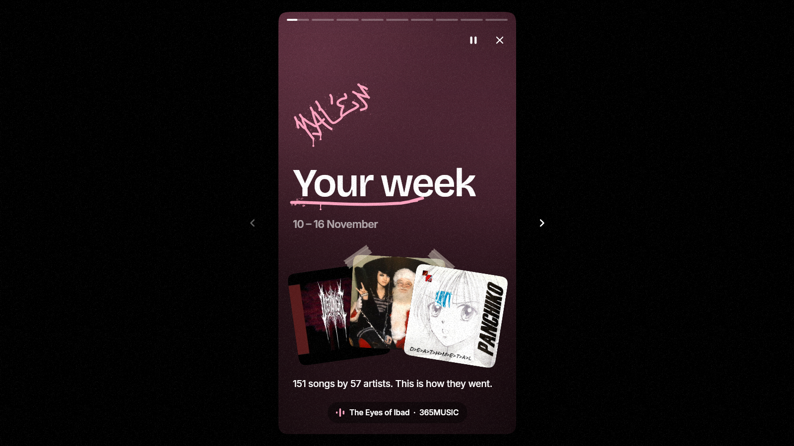 | 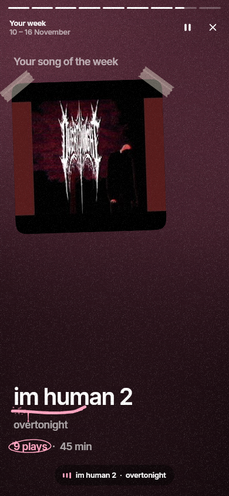 |
| --- | --- |


## Discord

Settings → Discord shows what you play on your Discord profile as **Listening to Valen**: the song
(its title opens it on its service), the artist, the cover with Valen's mark in the corner, the
time bar, where it plays from (Spotify, YouTube Music, SoundCloud or this device — "kept on this
device" for a download), your place in the queue, a button to open the song, and, if you turn it
on, the line being sung right now in place of the artist. Paused, the card says so and goes after
five minutes. It talks to the Discord desktop client over its local socket
(`$XDG_RUNTIME_DIR/discord-ipc-N`, Flatpak and snap builds included); nothing goes to Discord's
servers from Valen itself, and it waits quietly while Discord is closed.

Discord names a card after an application. Valen brings its own (id `1571814573663584338`, named
**Valen**, with the mark uploaded as the `valen` asset), so there is nothing to set up: turn it on
and the card is named like everyone else's. The mark is Discord's *small image*, drawn over the
cover's lower-right corner — Discord has no way to composite one picture onto another, so that slot
is what puts Valen on the cover. It must be uploaded once under the key `valen`:
`packaging/discord/valen.png` (1024×1024, the tag in white on a dark rounded square; the original
`packaging/discord/valentines.png` is a black silhouette and would disappear on a dark cover).
Whoever prefers their own application can set `VALEN_DISCORD_APP_ID`. The card's second button,
**Get Valen**, opens <https://github.com/dodo986/valen>; `VALEN_HOMEPAGE` points it elsewhere.

## Playlists

Valen's playlists are the app's, like its queue: one list can hold songs from all three services,
each playing on the service that can play it. Three ways in, on the Playlists screen:

- **Saved lists take songs too** — a Spotify, YouTube Music or SoundCloud list you imported, or a
  mix, can be added to (and songs taken out) like any other; what you add or remove is kept when the
  list is refreshed or the mix made again, and a rename stays. It all lives in Valen: nothing is
  written back to the account.
- **New playlist** — a blank sleeve on the shelf, named where it stands; it opens empty with a search
  of its own to fill it, and any song's menu can add to it from anywhere. A list of your own can be
  renamed in place, and its songs removed from their menu. Liked songs is the same kind of list,
  filled by the heart (newest first) and gone with its last song.

- **A pasted link** — a Spotify playlist (`open.spotify.com`, `spotify:playlist:`, `spotify.link`),
  a YouTube Music one (`list=`), or a SoundCloud set (`soundcloud.com/…/sets/…`). Valen reads the
  source's songs, keeps the ones it can play exactly, and matches the rest on the other services;
  the matching follows Mochy Music's importer (a normalised title and artist, duration, version
  words that must agree), hardened so a remix never stands in for the original. An entry that
  nothing matches is kept and shown as unmatched rather than replaced by the wrong song.
- **An account list** — Spotify, YouTube Music and SoundCloud, read from the account's own library
  when it is signed in. Reading never opens a browser: it uses the session the service's own page
  already holds (on Android, the session the service's sign-in page left in the WebView's cookies).

A song whose service is signed out on this machine is dimmed in its list, with the one way to sign
in. Re-importing the same source playlist replaces it in place instead of adding a second copy;
Refresh re-reads it. Removing a playlist touches Valen's library only. Every list but Liked songs
takes songs from a song's menu or its own search.

The library is data, not configuration: `$XDG_DATA_HOME/valen/playlists.json` on the desktop
(`~/.local/share/valen/playlists.json`), the app's files directory on Android. The settings file
stays as it was.

## Build and run (Linux)

Everything the build needs is project-local and git-ignored: JDK 21, Android SDK, Chrome and the
Gradle home live under `.tools/`. `scripts/env.sh` points the build at them.

Playing YouTube Music and SoundCloud natively needs `ffplay` from **FFmpeg** on `PATH`
(`ffmpeg` in the distribution's repositories; `$VALEN_FFPLAY_BIN` overrides the binary). Spotify
additionally needs a Chrome/Chromium, which Valen finds itself.

```bash
cd valen
source scripts/env.sh
./gradlew :app-desktop:run
```

A start opens no browser. YouTube Music and SoundCloud search through their APIs and play through
FFmpeg; Spotify starts Valen's private Chrome (its own profile, DevTools on `127.0.0.1:9333`) the
first time Spotify is used — searching with Spotify enabled or opening its settings tile. A normal
start takes no arguments.

Packaging: `./gradlew :app-desktop:packageDeb` writes
`app-desktop/build/compose/binaries/main/deb/valen_1.0.0_amd64.deb`; see [Packages](#packages) for
the AppImage step. A desktop entry and icon for a hand-rolled install live in `packaging/`.

### Development flags

The desktop binary takes a few flags for the screenshot pass; they are not needed to use Valen.

```
valen [--width N] [--height N] [--route home|search|playlists|import|now-playing|queue|settings]
      [--query TEXT] [--play PROVIDER:ID] [--screenshot PATH]
```

`--play ytmusic:"daft punk"` searches that service and starts the first result. `--screenshot`
draws the window offscreen, lets it settle for five seconds (artwork included) and writes a PNG,
then exits.

### Packages

Both installers were rebuilt in the playlist pass and run from their unpacked output on this
machine (no system install, no sudo): each draws the Playlists screen from its own runtime, and the
earlier full smoke (a song played, MPRIS showed it, `position <s>` seeked and `next` advanced the
queue) still describes the same playback code. The AppImage was also checked in a real tiled window
after the window-scaling fix (see below). The packages do not carry FFmpeg; a machine without it
plays Spotify only.

| Output | Built with | Size |
| --- | --- | --- |
| `app-desktop/build/compose/binaries/main/deb/valen_1.0.0_amd64.deb` | `./gradlew :app-desktop:packageDeb` | 99.6 MB |
| `app-desktop/build/compose/binaries/main/app/Valen-1.0.0-x86_64.AppImage` | `./gradlew :app-desktop:packageAppImage && ./scripts/appimage.sh` | 112.3 MB |

The AppImage rebuilt for the 2026-11-15 playback follow-up has SHA-256
`362a2141b15c622c78921a8b54b5b35f9016a90169a5d0f08907e2dc2ff64d01` (114,498,040 bytes; interactive
playback not yet checked); the
`.deb`'s is `41c5df9a8b3844c91d21f10b41f3ed64b56682a9c987c294f6da35082c0d9f12` (99,623,724 bytes).

`packageDeb` needs `dpkg-deb` and `fakeroot`; the AppImage step needs `appimagetool`. Compose's
`packageAppImage` produces a jpackage app-image *directory* (`app/Valen/`), not a single file —
`scripts/appimage.sh` wraps that directory with a desktop entry, icon and `AppRun`, then calls
`appimagetool --no-appstream`. Run it with `--appimage-extract-and-run` where FUSE is unavailable.

The bundled runtime adds two JDK modules the trimmed runtime would otherwise leave out:
`jdk.security.auth` (dbus-java reads the uid through `UnixSystem`; MPRIS fails without it) and
`java.net.http` (the Chrome launcher probes DevTools with `HttpClient`). A packaged install still
needs a system Chrome/Chromium or `VALEN_CHROME_BIN`; the `.tools` Chrome is not shipped.

## Build and install (Android)

```bash
source scripts/env.sh
./gradlew :app-android:assembleDebug
adb install app-android/build/outputs/apk/debug/app-android-debug.apk
```

The debug package id is `app.valen.debug`; the release id is `app.valen`. Playback happens in
WebViews held by a foreground service, so audio continues with the screen off and the media
notification (play/pause/next/previous, lock screen, headset buttons) is the system control.
Google may refuse its account page inside an Android WebView; YouTube Music still plays signed out.


With Battery Saver on (or animations turned off in the system settings), Valen stops its
decorative motion (the drifting wash, the glass's orbiting light) and draws the glass solid
instead of blurred. Spotify's Web Player is loaded only once an account is signed in, or when a
Spotify search or play first needs it.
## Sign-in

- **Spotify** — Settings → Spotify → Connect opens the Web Player in the private Chrome page (desktop)
  or a full-screen WebView (Android). Free accounts play with Spotify's own ads.
- **YouTube Music** — Connect opens Google's sign-in page. Signed out, search and playback work; the
  account only adds the library and history.
- **SoundCloud** — Connect opens SoundCloud's own sign-in. Signed out, label tracks are 30-second
  previews, as SoundCloud serves them.

On the desktop, Connect always puts a window on screen, even though playback runs in a headless
browser: a headless Chrome is closed and reopened with a window, whether Valen started it or an
earlier run left it behind. When no window can be opened, the service says why instead of leaving
the button doing nothing.

Valen runs the page with an ordinary Chrome user agent, built from the browser's engine version:
the Web Player refuses a headless engine and a brand build it does not recognise (Helium, Edge,
Brave) by answering "Unsupported browser" instead of loading the player. Any Chromium-family
browser works through that, as long as it ships Widevine — Spotify's audio is DRM-protected.

Sessions persist in the private browser profile per service. Disconnect deletes that service's
cookies. Nothing is written to the settings file except volume, quality and the last service.

## Configuration

| Variable | Meaning | Default |
| --- | --- | --- |
| `VALEN_FFPLAY_BIN` | `ffplay` used for native YouTube Music and SoundCloud playback | `ffplay` on `PATH` |
| `VALEN_CHROME_BIN` | Chrome/Chromium binary Spotify's page runs in | `.tools/chrome/opt/google/chrome/chrome`, then the usual system paths |
| `VALEN_CHROME_PROFILE` | Directory of the private Chrome profile | `$XDG_DATA_HOME/valen/chrome` |
| `XDG_DATA_HOME` | Parent of the Chrome profile and `valen/playlists.json` | `~/.local/share` |
| `XDG_CONFIG_HOME` | Parent of `valen/settings.json` | `~/.config` |
| `VALEN_SPOTIFY_LOG` | `1` prints the Spotify Web Player bridge's own lines (refusals, device join, timeouts) to stderr | off |
| `VALEN_MPRIS_LOG` | `1` prints when the MPRIS service closes and from where | off |
| `VALEN_LYPRIO_URL`, `VALEN_LYPRIO_KEY` | Lyprio's address (HTTPS) and signing key (base64, 32 bytes); also read as `LYPRIO_BASE_URL`/`LYPRIO_HMAC_KEY`, or from `valen/lyprio.json`; they win over the build's own | the build's endpoint, else LRCLIB only |
| `XDG_CACHE_HOME` | Parent of `valen/audio` (songs kept), `valen/lyrics` and `valen/covers` (local songs' covers) | `~/.cache` |
| `VALEN_DOWNLOADS_DIR` | Where downloaded playlists are written | `$XDG_MUSIC_DIR/Valen`, else `~/Music/Valen` |
| `VALEN_FFPROBE_BIN`, `VALEN_FFMPEG_BIN` | FFmpeg's tools for local tags and for tagging downloads | on `PATH` |
| `VALEN_DISCORD_APP_ID` | A Discord application of one's own for the card, instead of Valen's | Valen's own |
| `VALEN_HOMEPAGE` | An `https://` page for the card's second button, which reads "Get Valen" | <https://github.com/dodo986/valen> |

No key, token, cookie or credential is stored in the repository. The only build-time secrets are
the optional Lyprio address and key, read from the builder's own `local.properties` (git-ignored,
like `.tools/`), a Gradle property or the environment, and carried into both the desktop app and
the APK. The desktop also takes them at runtime from `valen/lyprio.json` or the environment, which
win over the build's own.

## Modules

| Module | Role |
| --- | --- |
| `core` | `Track`, `MusicProvider`, `ProviderSignIn`, `PlaybackCoordinator` (the one queue), the playlist library and importer, settings |
| `ui` | Compose Multiplatform design system and the screens, shared by both platforms |
| `providers/*/…PlaylistCatalog` | Reading a service's playlists by link or from the account |
| `libs/api`, `libs/web`, `libs/engine`, `libs/spotify`, `libs/ytmusic` | Orpheon's provider-neutral API, page bridge, Spotify Web Player and YouTube Music implementations (GPL-3.0, vendored with headers) |
| `libs/audio` | Native playback: `NativePlayback` (resolve, cache, recover), `FfplayPlayer` (one FFmpeg process per stream, desktop), `SoundDsp` (the effects for Android's sink), `YoutubeAudio` (NewPipeExtractor), `SoundcloudAudio` (API + runtime client id) |
| `providers/spotify` | Spotify adapter on the vendored Web Player |
| `providers/native` | YouTube Music and SoundCloud adapters on desktop and Android: no page, no browser |
| `providers/lyrics` | Lyrics sources on both platforms: Lyprio (signed, word-timed) and LRCLIB, and the folder lyrics are kept in |
| `providers/ytmusic`, `providers/soundcloud` | The older page-based adapters (hidden WebView); no app builds them now |
| `host/desktop` | Chrome launcher, CDP page hosts, desktop sign-ins, MPRIS |
| `host/android` | `ExoAudioPlayer` (ExoPlayer sink with the effects), WebView hosts for Spotify and the sign-ins, Widevine, Android sign-ins, foreground playback service |
| `app-desktop`, `app-android` | Entry points and platform wiring |

The contract every adapter implements is in [`docs/provider-contract.md`](docs/provider-contract.md).
`PlaybackCoordinator` owns the queue and calls exactly one adapter at a time; adapters never invent a
queue of their own.

## What is verified

- Desktop app builds and runs; YTM and SoundCloud play **signed out** with position advancing and the
  queue auto-advancing, with **no browser process started**: verified on a machine with no Chrome
  open (YouTube Music: 264 s track, pause froze the clock, resume continued, `seek 120` restarted
  FFmpeg at 120 s, and a seek to 261 s advanced to the next queue song).
- Spotify plays a signed-in account on the desktop: a song starts, its position advances, `next`
  and `previous` move through Valen's queue, `seek` jumps, pause/resume work, and the queue
  auto-advances at the end of a song — all with the Chrome window in the background and the app
  driven over MPRIS (`playerctl -p valen ...`).
- MPRIS: `playerctl -p valen status|metadata|position|pause|play|next|previous` drives the app;
  `position <seconds>` seeks. (A seek used to take the whole MPRIS name off the bus: the `Seeked`
  signal was assembled by hand and reached the daemon malformed; it is now declared as part of the
  MPRIS player interface, as dbus-java requires.)
- The `.deb` and the `.AppImage` were unpacked and run end to end: each starts its private Chrome
  cold, draws the UI, plays Spotify, registers MPRIS, seeks and advances the queue.
- The `.AppImage` is `app-desktop/build/compose/binaries/main/app/Valen-1.0.0-x86_64.AppImage`
  (112,310,776 bytes, sha256 `b1d818e5fb16d2662ebd9d16b9d2322a4470d0e9766f0d849015924d6d079cce`);
  the rebuilt `.deb` is 99,623,724 bytes, sha256
  `41c5df9a8b3844c91d21f10b41f3ed64b56682a9c987c294f6da35082c0d9f12`. Both were rendered from
  their unpacked output after the playlist pass.
  From it: the Web Player loads as a real player page in the machine's Chromium (Helium), no
  "Unsupported browser", the bridge answers `token.get` and `player.play`, and Widevine is
  available. Playback itself needs the account signed in once.
- **Tiled windows fill correctly**: on niri, a window resized by the compositor (including
  `expand-column-to-available-width`) now takes Compose's content window with it — frame, content
  window and Skia canvas all measured 1874×998 where they used to be a 1440×900 drawing stuck in
  the corner. Verified with the distributable and again from the rebuilt AppImage. The fix is
  AWT's own non-reparenting switch, set from `Main.kt` for tiling compositors only, with the
  package opening `java.desktop/sun.awt.X11` for it.
- Mouse interaction on a real window (hover, rail dragging, queue drag, page cross-fade) is still
  unverified; only geometry and rendered frames were checked.
- Android debug APK builds (`app-android/build/outputs/apk/debug/`). On the API 35 emulator
  (silent): YouTube Music and SoundCloud (progressive and HLS) play natively through ExoPlayer and
  keep playing past where the old hidden-page player stalled; Nightcore runs at 1.25× with its
  pitch; the media session follows play/pause/next and the effects' speed; the restored song starts
  ~55 ms after Play (its stream is found at start); a signed-out Spotify copy says to sign in. Not
  checked on a real phone, and Spotify with a signed-in account was not tried there.
- Core queue/settings tests (`./gradlew :core:jvmTest`), SoundCloud parser tests, and the vendored
  Orpheon test suites pass.
- The interface is walked by `./gradlew :ui:jvmTest` against services that answer instantly: every
  screen at four window sizes, then search → play → queue → stage → settings on a wide window, the
  sheets on a phone, and playlists → open from Home → play → import a link no service can read.
- The playlist library and importer are covered by `./gradlew :core:jvmTest`: link parsing for all
  three services, the matching scorer (version words, artist floor, live-album cap), re-import
  replacing in place, unmatched entries kept, and one mutex around every library change.
- Reading a real account's playlists end to end still needs a sign-in on this machine; the readers
  are built and covered by the shared contract tests, not by a signed-in account.

Known limits: native playback needs `ffplay` (a machine without FFmpeg plays Spotify only, and the
first play says so); the streaming (HLS) SoundCloud tracks the old page adapter refused now play,
but SoundCloud keeps some tracks preview-only when signed out; Spotify signed-out search waits for
the Web Player to start and refuses after 8 s; SoundCloud streams newer label releases only
copy-protected (encrypted HLS), which Valen does not play, so those are left out of search;
a playlist's unmatched entries are listed but cannot be fixed in place yet (the matcher runs at
import time only); YouTube Music reports its own ads and they play through. Spotify playback with a
real account needs
one manual sign-in in the private Chrome page — the free-account path is Orpheon's, including its
documented refusals. **The Spotify Web Player only fetches a song's audio while its page has focus**
(an unfocused page accepts the play command, its media element stays at `readyState 0` and no audio
is requested). On the desktop, Valen emulates that focus over CDP
(`Emulation.setFocusEmulationEnabled`), so the Chrome window may stay in the background; the
Android WebView has no equivalent switch, and a backgrounded WebView is unverified.

## Licence and credit

GPL-3.0. Valen reuses Orpheon's Spotify/YouTube Music playback code and page plumbing, resolves
YouTube streams with NewPipeExtractor, plays them through FFmpeg (`ffplay`), and borrows design ideas
from Mochy
Music's design ideas; see [`NOTICE`](NOTICE) for the file-level credits, fonts (Bricolage Grotesque,
Inter) and the icon set (Material Symbols Rounded).
